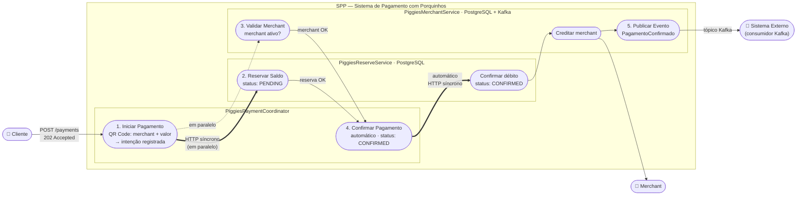
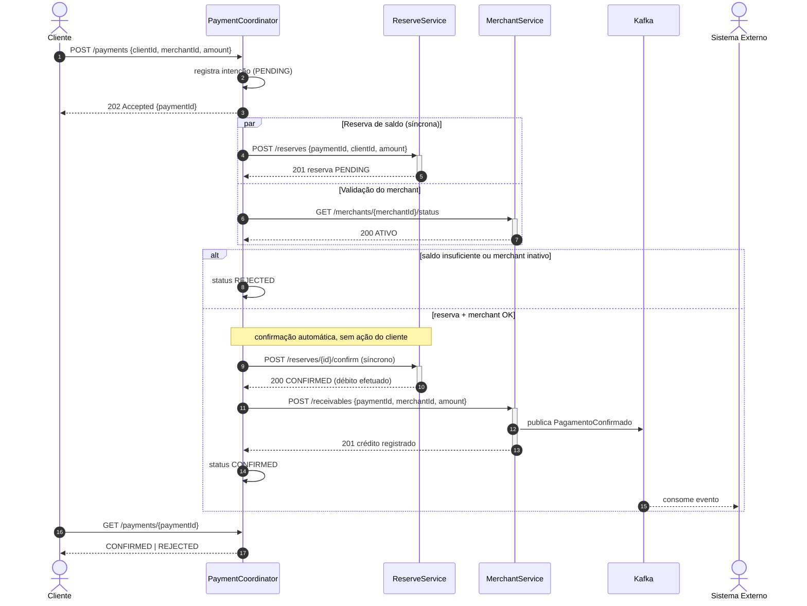

## Instructions

No Inter trabalhamos com `contract-first`. O primeiro passo de qualquer entrega é
definir os contratos entre os microserviços usando OpenAPI ou JSON Schema — um contrato
por serviço, definido antes da implementação. Eventos publicados (ex.: Kafka) também
devem ter schema.

Os clientes do Inter não gostam de ficar olhando para uma ampulheta na tela, por
isso todo serviço de borda precisa trabalhar de forma assíncrona.

Testes unitários e de integração são obrigatórios.

Planejem as entregas. Tempo é um recurso limitado e a gestão do tempo é parte do desafio.

Trabalhem em equipe. Vocês não estão competindo entre si. Vocês vencem juntos ou perdem juntos.

Uma entrega parcial que faz alguma coisa vale mais do que um monte de código que não
realiza nada.

Vocês podem usar IA, consultar a internet e usar qualquer outra ferramenta à sua
disposição, desde que tudo seja anexado ao projeto e comitado (pesquisas, prompts,
códigos de referência, etc.).

Contudo, usem com responsabilidade:
- Vocês precisarão resolver bugs e responder questões sobre a implementação. Responder
  "Não sei, a IA que fez assim" é critério de eliminação.
- Fiquem atentos quanto a propriedade intelectual e nunca utilizem códigos ou documentos
  que vocês não estão autorizados a publicar.

Boa sorte. Vocês têm 1h30 para concluir o desafio.


## SPP — Sistema de Pagamento com Porquinhos

Piggie é a nova stablecoin do Inter. O desafio é implementar o Sistema de Pagamento com Porquinhos (SPP).

Um pagamento envolve algumas etapas:

1. Cliente inicia um pagamento por meio de um QR Code que identifica o merchant e a quantidade de Piggies
2. Em paralelo, a intenção de pagamento é registrada, o saldo do cliente é reservado e o merchant é validado
3. Quando as três operações concluem com sucesso, o pagamento é confirmado: Piggies são debitados do cliente, creditados ao merchant e o evento é publicado para outros sistemas

Exemplo:
- Cliente A inicia pagamento de 100 Piggies ao Merchant X
- Intenção de pagamento é registrada
- Reserva de 100 Piggies é criada na conta do Cliente A
- Merchant X é validado como ativo
- Pagamento é confirmado: 100 Piggies debitados de A, 100 creditados a X

**IMPORTANTE** nessa dinâmica vamos implementar uma versão simplificada do sistema:
- Pagamentos são sempre por um valor inteiro de Piggies
- Não há cancelamento após confirmação

Vocês devem implementar 3 serviços:

- **PiggiesPaymentCoordinator** é o ponto de entrada do App, registra a intenção de pagamento e orquestra a confirmação de ponta a ponta.
- **PiggiesReserveService** reserva e confirma o débito do cliente. Persiste o estado da reserva em PostgreSQL.
- **PiggiesMerchantService** valida o merchant e registra o crédito. Persiste recebíveis em PostgreSQL e consome/publica eventos de pagamento via Kafka.


## Diagramas
> O cliente recebe `202 Accepted` na hora (borda assíncrona). Internamente, o Coordinator
> chama o ReserveService de forma **síncrona** (HTTP, aguardando a resposta) e, quando
> reserva + merchant estão OK, **confirma o débito automaticamente**, sem nenhuma ação do cliente.

### Caso de uso



### Sequência




## Como subir o projeto

### Pré-requisitos
- **Docker** com Docker Compose v2 (Docker Desktop no Windows/macOS) em execução.
- Portas livres: `5432` (Postgres), `9092` (Kafka), `8080` · `8081` · `8082` (serviços), `8088` · `8089` (documentação).
- Para rodar fora do Docker (opcional): JDK 25 (`mise.toml`) e o Maven Wrapper do repositório (`./mvnw`).

### Subida rápida (tudo em containers)
```bash
git clone https://github.com/csfinfor-lab/entrevista_inter.git
cd entrevista_inter
docker compose --profile app --profile docs up -d --build
```
O primeiro build baixa imagens e dependências Maven (alguns minutos). Acompanhe com `docker compose --profile app --profile docs ps` — os serviços estão prontos quando aparecem como `running`; o log de cada um termina com `Startup completed`.

| O quê | Onde |
|-------|------|
| **Coordinator** (API de entrada) | http://localhost:8080 |
| Reserve | http://localhost:8081 |
| Merchant | http://localhost:8082 |
| **Swagger UI** dos contratos OpenAPI (com "Try it out") | http://localhost:8088 |
| **Documentação**: este README, diagramas Mermaid, vault do Obsidian, registros de IA | http://localhost:8089 |
| Health check de cada serviço | `/health` na porta do serviço |

### Testando manualmente
Dados de seed: clientes **A** (1000 Piggies), **B** (50), **POOR** (0); merchants **X** (ativo) e **Y** (inativo).

```bash
# 1. inicia o pagamento (resposta imediata: 202 + paymentId, status PENDING)
curl -i -X POST http://localhost:8080/payments   -H 'Content-Type: application/json'   -d '{"clientId":"A","merchantId":"X","amount":100}'

# 2. consulta o resultado (CONFIRMED, ou REJECTED com o motivo em "reason")
curl http://localhost:8080/payments/<paymentId>

# conferências opcionais
curl http://localhost:8081/reserves/<paymentId>          # estado da reserva
curl http://localhost:8082/merchants/X/receivables       # recebíveis do merchant X
```
O mesmo fluxo pode ser feito pelo Swagger UI (http://localhost:8088, escolha *Coordinator* → `POST /payments`).

### Testes
```bash
# Testes que não precisam de Docker (rápidos)
docker compose --profile test run --rm tests-unit

# Todos os testes, inclusive os de integração com Testcontainers (Postgres e Kafka)
docker compose --profile test run --rm tests

# Teste ponta a ponta contra os serviços no ar: caminho feliz, saldo insuficiente, merchant inativo
# e inexistente, idempotência e validação do body
docker compose --profile app --profile e2e run --rm e2e
```
Sem containers: `./mvnw test` (os testes de integração exigem Docker em execução, por causa do Testcontainers).

### Parar e limpar
```bash
docker compose --profile app --profile docs down        # para os containers (mantém os dados do banco)
docker compose --profile app --profile docs down -v     # também apaga o volume do Postgres (volta ao seed)
```

### Alternativa: serviços na máquina, infraestrutura no Docker
```bash
docker compose up -d                       # só Postgres :5432 e Kafka :9092
./mvnw -pl coordinator -am mn:run          # um terminal por serviço
./mvnw -pl reserve -am mn:run
./mvnw -pl merchant -am mn:run
./scripts/e2e.sh                           # (opcional) cenários ponta a ponta
```

### Problemas comuns
| Sintoma | O que fazer |
|---------|-------------|
| `port is already allocated` | Outra aplicação usa a porta; encerre-a ou ajuste o mapeamento em `docker-compose.yml` |
| Serviço reiniciando / `Connection refused` ao Postgres | Aguarde o Postgres ficar *healthy* e rode o `up` de novo; veja `docker compose logs postgres` |
| Banco com dados/schema antigos | `docker compose --profile app --profile docs down -v` e suba novamente |
| Docker não responde | Reinicie o Docker Desktop e aguarde o engine ficar *Running* |
| Diagramas não aparecem em :8089 | O site carrega scripts de CDN; o navegador precisa de acesso à internet |
| `tests` não encontra o Docker | Use `tests-unit`, ou rode `./mvnw test` direto na máquina |

Mais detalhes (rede, variáveis de ambiente, perfis do compose): `docs/obsidian-vault/13 - Docker.md`.

## Estrutura do repositório

```
contracts/          OpenAPI de cada serviço + JSON Schema do evento Kafka (contract-first)
coordinator/        PiggiesPaymentCoordinator  (porta 8080)
reserve/            PiggiesReserveService      (porta 8081)
merchant/           PiggiesMerchantService     (porta 8082)
testing-support/    bases de teste (Testcontainers) e validação de contratos
scripts/e2e.sh      teste ponta a ponta (bash + curl)
docker-compose.yml  infraestrutura, serviços, documentação e testes (perfis app / docs / test / e2e)
Dockerfile          imagens: tooling (JDK 25 + Maven), builder e service
docs/               diagramas, vault do Obsidian (docs/obsidian-vault) e registros de IA (docs/ai)
```
